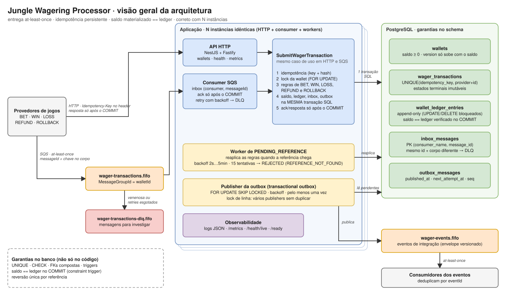
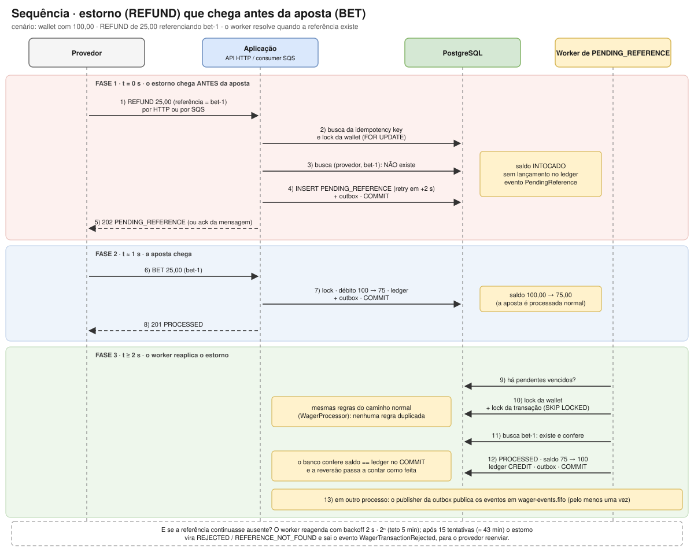

# ARCHITECTURE

> Decisões, trade-offs e limitações da implementação. **Como rodar, configurar e testar: [`README.md`](README.md).** O enunciado do desafio técnico não faz parte deste repositório; as referências a "seção N do enunciado" apontam para ele.

## Visão geral



Fonte editável: [`docs/architecture.drawio`](docs/architecture.drawio) (abre em [app.diagrams.net](https://app.diagrams.net)). O SVG e o `.drawio` são gerados juntos por `bun run diagram`.

### Como ler o desenho

1. **Entrada:** o provedor envia a transação por **HTTP** (com `Idempotency-Key`) ou pela **fila SQS** (`wager-transactions.fifo`, agrupada por wallet). Mensagens inválidas ou que esgotam as tentativas vão para a **DLQ**.
2. **Um só caso de uso:** HTTP e SQS chamam o mesmo `SubmitWagerTransaction`: idempotência (key + hash do payload), lock da wallet (`FOR UPDATE`), regras de negócio e gravação.
3. **Uma única transação SQL:** transação, saldo, lançamento no ledger, inbox e evento da outbox são confirmados juntos, ou nada é. A resposta HTTP e o ack da mensagem só acontecem **depois do COMMIT**.
4. **Garantias no banco:** `UNIQUE`, `CHECK`, triggers (ledger append-only, estados terminais imutáveis) e a verificação `saldo == ledger` no COMMIT valem mesmo que o código erre.
5. **Eventos:** o publisher da outbox (`SKIP LOCKED`, vários em paralelo) entrega os eventos em `wager-events.fifo` pelo menos uma vez; quem consome deduplica por `eventId`. O worker de `PENDING_REFERENCE` reaplica reversões cuja referência chegou fora de ordem.
6. **N instâncias idênticas:** nenhuma tem estado local; elas se coordenam só pelo banco, então o sistema continua correto com 1, 3 ou mais processos.

### Duas entradas, um caso de uso

O desafio pede as duas. A **API** é a porta síncrona (o provedor espera o resultado); a **fila** é a assíncrona (o provedor enfileira e consulta depois, ou escuta os eventos). Ambas montam o **mesmo comando** e chamam o mesmo caso de uso, então regras, idempotência, lock e gravação existem uma única vez. O conteúdo de negócio é idêntico; muda o envelope:

```http
POST /wagering/transactions
Idempotency-Key: provider-a:transaction-123          # a chave vai no HEADER
X-Correlation-Id: abc-1                              # opcional

{ "providerId": "provider-a", "externalTransactionId": "transaction-123", "playerId": "…", "walletId": "…",
  "roundId": "round-987", "gameId": "fortune-chimp", "kind": "BET",
  "money": { "amount": "25.00", "currency": "BRL" } }
```

```jsonc
{ "messageId": "msg-123",                            // identifica a MENSAGEM (só existe na fila)
  "type": "WagerTransactionRequested", "occurredAt": "2026-07-29T15:00:00.000Z",
  "data": { "providerId": "provider-a", "externalTransactionId": "transaction-123",
            "idempotencyKey": "provider-a:transaction-123",   // a chave vai DENTRO de data
            "playerId": "…", "walletId": "…", "roundId": "round-987", "gameId": "fortune-chimp",
            "kind": "BET", "money": { "amount": "25.00", "currency": "BRL" } } }
```

| Aspecto | API | SQS |
|---|---|---|
| Idempotency key | header `Idempotency-Key` | campo `data.idempotencyKey` |
| Identificador da entrega | não tem | `messageId` (usado pela inbox) |
| Correlação nos logs | `X-Correlation-Id` (ou gerado) | o próprio `messageId` |
| Resultado devolvido | resposta HTTP (`201`/`200`/`202`/`422`…) | nenhuma: a mensagem é apagada (ack), devolvida (retry) ou movida para a DLQ |
| Payload inválido | `400` | DLQ |
| Rejeição de negócio (ex.: sem saldo) | `422` com `failureCode` | resultado normal: grava `REJECTED` e **apaga** a mensagem |
| Falha transitória (banco fora) | `503` + `Retry-After` | volta à fila com backoff (retry) |

### Como o sistema reconhece "a mesma" requisição

| Identificador | Existe em | Protege contra |
|---|---|---|
| `messageId` + nome do consumer (**inbox**) | só SQS | o SQS **reentregar** a mesma mensagem |
| `idempotencyKey` | API e SQS | o provedor **reenviar o mesmo pedido** (inclusive numa mensagem nova, ou por outro canal) |
| `(providerId, externalTransactionId)` | API e SQS | o mesmo id de transação usado sob chaves diferentes |

O **`payloadHash`** (SHA-256 do JSON canônico só dos campos de negócio; não olha header nem `messageId`) decide o que fazer ao achar algo: mesmo hash = **replay** (devolve o resultado original, com o saldo da época); hash diferente = **conflito** (`409` na API, DLQ na fila). Na fila, a inbox também compara o conteúdo: mesmo `messageId` com **corpo diferente** é erro permanente (seção 10).

Como os dois canais montam o mesmo comando e o hash só usa campos de negócio, o mesmo pedido que chega por HTTP e depois por fila (ou o contrário) é um replay, sem novo débito. Isso decorre de ambos usarem o mesmo caso de uso; os testes cobrem a deduplicação **dentro de cada canal** e os dois canais disputando a mesma wallet (`test/e2e/multiprocess.test.ts`), mas não há um teste específico de "o mesmo pedido por HTTP e depois por fila".

### Fluxo de persistência de uma aposta

| Tabela | Guarda | Papel |
|---|---|---|
| `wager_transactions` | cada pedido recebido e o seu desfecho (`PENDING`, `PROCESSED`, `REJECTED`…) | "o que me pediram" |
| `wallet_ledger_entries` | cada movimento de saldo, com `balance_before`/`balance_after` (append-only) | "o que mudou no saldo" |
| `wallets` | o saldo atual e a `version` | "quanto tem agora"; o banco garante que bate com o ledger |
| `inbox_messages` | as mensagens SQS já vistas | dedup de entrega |
| `outbox_messages` | os eventos a publicar | atomicidade entre mudança e evento |

```
(só SQS)  1. INSERT inbox (consumer, messageId)
               já existia + mesmo corpo       -> releitura: segue para o 2 e vira replay
               já existia + corpo diferente   -> DLQ, FIM
          2. já existe essa idempotency key?  -> replay / conflito, FIM        (sem lock)
          3. SELECT wallet FOR UPDATE                                          (fila por wallet)
          4. repete o passo 2, agora com o lock
          5. aplica as regras (saldo suficiente? referência ok?...)
          ── daqui até o COMMIT: UMA transação SQL ──
          6. INSERT wager_transactions    (o pedido + o resultado)
          7. UPDATE wallets               (balance, version+1  WHERE version = a lida)
          8. INSERT wallet_ledger_entries (quando o saldo muda)
          9. INSERT outbox_messages       (os eventos)
(só SQS) 10. UPDATE inbox SET processed_at
         11. COMMIT   -> o banco confere: wallet.balance == ledger
         ── só agora ──
         12. API: devolve a resposta  |  SQS: DeleteMessage (ack)
         13. (outro processo) o publisher envia os eventos
```

Exemplo: wallet com 1.000,00 e uma `BET` de 25,00 gravam `wager_transactions` (`PROCESSED`, `balance_snapshot` 975,00), `wallets` (`balance` 975,00, `version` 2), um lançamento `DEBIT` 25,00 (`before` 1.000,00, `after` 975,00) e 2 linhas na outbox (`WagerTransactionProcessed` e `WalletBalanceChanged`). Os outros desfechos:

| Situação | O que é gravado |
|---|---|
| Sem saldo | `wager_transactions` `REJECTED` + `failure_code`; **sem** ledger, saldo intocado; evento `WagerTransactionRejected`. Repetir o pedido devolve a **mesma** rejeição |
| `LOSS` | `wager_transactions` `PROCESSED`; sem ledger (não move saldo); só o evento `WagerTransactionProcessed` |
| `REFUND`/`ROLLBACK` sem a referência | `wager_transactions` `PENDING_REFERENCE` + `next_attempt_at`; sem ledger; o worker reprocessa depois (seção 7) |
| Replay | **nada novo é gravado**; devolve o resultado lido da linha existente |

### Pontos de falha

| O processo morre… | O que acontece |
|---|---|
| antes do commit | nada foi gravado (a linha da inbox também some no rollback); a mensagem reaparece e é tratada como nova |
| depois do commit, antes do ack | a mensagem reaparece, a inbox/idempotência a reconhece e vira replay: um único débito |
| depois do commit, antes de publicar | o evento está na outbox, pendente; outra instância o publica |
| depois de publicar, antes de marcar `published_at` | o evento sai duas vezes; seguro porque quem consome deduplica por `eventId` |

Cada linha está coberta por testes com Postgres e SQS reais (`test/integration`, `test/concurrency` e `test/e2e`, incluindo `kill -9`). Detalhes: concorrência e idempotência na seção 6.1, outbox na 9, consumer na 10.

## 1. Camadas

```
src/
  domain/          Money, Wallet, WagerTransaction, WalletLedgerEntry, Inbox/Outbox, eventos, erros
                   (puro: sem NestJS, sem ORM)
  application/     use cases e portas (repositórios, publisher, relógio, ids)
  infrastructure/  MikroORM, migrations, SQS, outbox publisher
  interface/       controllers HTTP, consumer SQS, health, métricas
```

O mesmo use case atende a entrada HTTP e o consumer SQS.

## 2. Decisões

| Tema | Decisão | Justificativa |
|---|---|---|
| ORM | MikroORM | `EntityManager.transactional()`, `LockMode.PESSIMISTIC_WRITE`, Unit of Work explícito. Entidades de persistência separadas do domínio, que não depende do ORM. |
| Dinheiro | `decimal.js` no domínio; `NUMERIC(20,2)` + coluna `currency` no banco | Exatidão; nenhum `number`/`float`. |
| Concorrência | Lock pessimista por wallet (`SELECT … FOR UPDATE` na linha) | Unidade de concorrência = `walletId`. Sem lock global. O banco serializa entre N instâncias. _(detalhar trade-offs vs. otimista)_ |
| Idempotência | `UNIQUE` no banco + `payloadHash` | Mesmo hash = replay; hash diferente = conflito. Sem cache em memória. |
| Inbox / Outbox | Mesma transação SQL da mudança financeira | Atomicidade; publisher com `FOR UPDATE SKIP LOCKED`. |
| Ordenação SQS | FIFO com `MessageGroupId = walletId` | Otimização apenas; a garantia final são as constraints e a inbox. |
| Autenticação | Não implementada; ponto de extensão explícito | Não pontua no desafio. Desenho alvo: IdP externo (Keycloak/Zitadel) validando JWT via guard. _(detalhar)_ |

### Money

- `amount` entra e sai como string decimal, escala fixa 2.
- Entrada aceita 0–2 casas decimais e é **normalizada** para 2 (`"25"` → `"25.00"`); mais de 2 casas, sinal, notação científica, `NaN`/`Infinity` e string vazia são rejeitados.
- Valores negativos só existem internamente (resultado de `subtract`/`negate`); nunca entram por contrato.
- Moeda: três letras maiúsculas (ISO-4217). Operações entre moedas diferentes lançam `CurrencyMismatchError`.

## 3. Schema e constraints

Migration reversível (`up`/`down`) em `src/infrastructure/persistence/migrations/`. Tudo abaixo é garantido **no banco** e provado em `test/integration/schema.test.ts` contra PostgreSQL real.

| Garantia | Mecanismo |
|---|---|
| Saldo nunca negativo | `CHECK (balance >= 0)` em `wallets` |
| Uma wallet por `playerId` + moeda | `UNIQUE (player_id, currency)` |
| `version` só sobe (+1) quando o saldo muda | trigger `wallets_guard` (rejeita também `DELETE` e troca de identidade) |
| Idempotência | `UNIQUE (idempotency_key)` e `UNIQUE (provider_id, external_transaction_id)` |
| Ledger imutável | triggers `BEFORE UPDATE/DELETE/TRUNCATE` → exceção (append-only) |
| Aritmética do lançamento | `CHECK (before ± amount = after)` |
| Um lançamento por (wallet, transação) | `UNIQUE (wallet_id, transaction_id)` |
| Ledger encadeado | trigger: `balance_before` = último `balance_after` da wallet |
| **Saldo materializado == ledger** | `CONSTRAINT TRIGGER ... DEFERRABLE INITIALLY DEFERRED`: verificado **no commit**; alterar saldo sem lançamento (ou o inverso) aborta a transação inteira |
| Lançamento da wallet/moeda certas | FKs compostas `(wallet_id, currency)` e `(transaction_id, wallet_id)` |
| Terminais imutáveis | trigger `wager_transactions_guard`: `PROCESSED/REJECTED/FAILED` não mudam; colunas de negócio imutáveis; sem `DELETE` |
| Reversão única por tipo | índice único parcial `(reference_transaction_id, kind) WHERE status='PROCESSED' AND kind IN ('REFUND','ROLLBACK')` |
| Consistência de status | `CHECK`s: `failure_code` ⇔ REJECTED/FAILED; `processed_at` ⇔ PROCESSED; REFUND/ROLLBACK exigem referência |
| Dedup de inbox | `PRIMARY KEY (consumer_name, message_id)` |
| Outbox | `seq` identity + índice parcial `WHERE published_at IS NULL` |

Observações:
- O trigger de consistência é o que sustenta a invariante `wallet.balance == saldo reconstruído pelo ledger` mesmo se algum caminho de código errar. Custo: uma leitura indexada `(wallet_id, seq)` por wallet alterada, por commit.
- Wallet inexistente **não é persistida** como transação (a FK impede) — vira 404 na API / erro permanente na fila. `WALLET_MISMATCH` cobre apenas wallet que existe mas pertence a outro player; essa, sim, fica `REJECTED` e auditável.
## 4. Taxonomia de `failureCode`

Código estável e legível por máquina (`src/domain/failure-code.ts`). A coluna indica o que o provedor deve fazer.

| Status | Código | Situação | Provedor deve |
|---|---|---|---|
| REJECTED | `INSUFFICIENT_FUNDS` | BET sem saldo | não reenviar a mesma; nova tentativa só como nova transação |
| REJECTED | `REVERSAL_WOULD_OVERDRAW` | reversão deixaria saldo negativo (distinto do anterior: caso operacional) | não reenviar; tratar operacionalmente |
| REJECTED | `REFERENCE_NOT_FOUND` | referência nunca chegou (limite do 7.1 esgotado) | corrigir referência / enviar a original antes |
| REJECTED | `REFERENCE_NOT_PROCESSED` | referência existe mas foi rejeitada/falhou | não reenviar |
| REJECTED | `REFERENCE_MISMATCH` | provider/player/wallet/moeda/rodada divergem | corrigir payload |
| REJECTED | `INVALID_REFERENCE_KIND` | REFUND de não-BET; ROLLBACK de LOSS/ROLLBACK | corrigir payload |
| REJECTED | `ALREADY_REVERSED` | referência já revertida por este tipo | desistir (já tratado) |
| REJECTED | `AMOUNT_MISMATCH` | valor ≠ valor da referência (reversão parcial fora de escopo) | corrigir payload |
| REJECTED | `WALLET_MISMATCH` | wallet inexistente ou de outro player | corrigir payload |
| REJECTED | `CURRENCY_MISMATCH` | moeda ≠ moeda da wallet | corrigir payload |
| FAILED | `PROCESSING_ERROR` / `RETRIES_EXHAUSTED` | erro permanente de infraestrutura | reenviar após alerta/correção |

## 5. `payloadHash` (JSON canônico)

`src/domain/payload-hash.ts`: (1) seleciona só campos de negócio (`providerId`, `externalTransactionId`, `playerId`, `walletId`, `roundId`, `gameId`, `kind`, `money`, `referenceExternalTransactionId`) — header `Idempotency-Key` e metadados de transporte ficam de fora; (2) normaliza `money` via `Money` (`"25"` ≡ `"25.00"`); (3) omite `undefined`; (4) JSON canônico com chaves ordenadas recursivamente; (5) SHA-256 em hex.

## 6. Transições de status de `WagerTransaction`

```
PENDING           -> PROCESSED | PENDING_REFERENCE | REJECTED | FAILED
PENDING_REFERENCE -> PROCESSED | REJECTED | FAILED
PROCESSED | REJECTED | FAILED: terminais (transicionar lança InvalidTransactionStateError)
```

- `OPENING` é criado só por `WagerTransaction.opening()` (interno); `create()` o rejeita.
- `REFUND`/`ROLLBACK` exigem referência; `BET` não aceita; `WIN`/`LOSS` aceitam opcionalmente.
- Valor deve ser positivo; `LOSS` aceita zero.
- `ROLLBACK` produz o lançamento inverso ao da referência (BET→CREDIT, WIN/REFUND→DEBIT).
- `Wallet.open` já nasce com o saldo inicial (`version` 1); o lançamento de abertura sai de `Wallet.openingEntry()`, gravado na mesma transação SQL.
## 6.1 Concorrência e idempotência (use case `SubmitWagerTransaction`)

Fluxo, numa única transação SQL (`MikroOrmUnitOfWork`, `EntityManager` isolado por chamada, READ COMMITTED):

1. (SQS) registra a mensagem na **inbox** (`INSERT … ON CONFLICT DO NOTHING`). Se `(consumer, messageId)` **já existia**, o registro original é lido e o conteúdo é comparado (`payload_hash`): **mesmo corpo** = releitura legítima, que segue para o passo 2 e vira replay; **corpo diferente** = `messageId` reutilizado, erro permanente (`MessageIdReuseError` → DLQ) e **nada é processado**. Ver seção 10.
2. **Caminho rápido**: busca por `idempotency_key` (e por `(provider, id externo)`). Achou com o mesmo `payloadHash` → **replay**; hash diferente → **409**. Replay não toma lock.
3. **Lock pessimista da wallet**: `SELECT … FOR UPDATE` (`LockMode.PESSIMISTIC_WRITE`) na linha da wallet. A unidade de concorrência é a `walletId`; wallets distintas não se bloqueiam e não há lock global. Cada operação toca **uma** wallet, então não há deadlock por ordem de lock.
4. Repete a busca de idempotência já com o lock: duplicatas concorrentes esperam no passo 3 e, ao obter o lock, enxergam a transação já commitada (READ COMMITTED reavalia o snapshot a cada statement) → viram replay, sem erro.
5. Aplica a regra de negócio (`WagerProcessor`), e grava na ordem das FKs: transação → saldo (`UPDATE … WHERE version = :lida`) → lançamento → outbox → marca inbox.

**Por que pessimista e não otimista:** wallets quentes (muitas apostas por segundo no mesmo jogador) gerariam tempestade de retries com otimismo; o lock de linha enfileira no próprio banco, com latência previsível e sem perda de trabalho. O `UPDATE … WHERE version` e o `CHECK`/trigger do schema são defesa em profundidade, não o mecanismo principal. **Trade-off:** throughput por wallet é serial (aceitável: o saldo é inerentemente sequencial); uma transação lenta segura a wallet, por isso a transação só faz I/O no banco (nada de chamadas externas dentro dela; a publicação sai pela outbox).

**Corrida entre chaves diferentes** (mesma key em wallets distintas): o lock não as serializa, então a `UNIQUE` do banco decide. O perdedor recebe `DuplicateKeyError`, o use case reexecuta (até 3 vezes) e na nova transação vira replay/conflito.

### Interpretações adotadas (além do texto do desafio)
- **Reversão única por referência, para qualquer tipo**: a regra 4 pede unicidade por tipo; adotamos `REFUND` *ou* `ROLLBACK` no máximo uma vez por referência (índice único parcial), evitando crédito duplicado quando os dois disputam o mesmo alvo.
- **Replay de rejeições** devolve o resultado original (inclusive `failureCode` e o saldo da época), gravado em `balance_snapshot`.
- **`ROLLBACK` de `REFUND` é permitido** (debita de volta); de `LOSS` ou de `ROLLBACK` não.
- A referência de um **`WIN` é informativa**: não bloqueia o crédito.
- **Mesmo id externo sob outra idempotency key** é conflito (409).
- Referência existente mas ainda em trânsito (`PENDING`/`PENDING_REFERENCE`) mantém a reversão em `PENDING_REFERENCE`.

## 7. Referências fora de ordem (`PENDING_REFERENCE`)



O diagrama mostra o caso típico: o estorno chega **antes** da aposta. Ele é guardado sem efeito no saldo e, quando a aposta aparece, o worker (um laço dentro de cada instância da aplicação, não um job externo) o reaplica com as mesmas regras do caminho normal. Fonte editável: [`docs/sequence-pending-reference.drawio`](docs/sequence-pending-reference.drawio) (gerado por `bun run diagram`).

**Fluxo.** Um `REFUND`/`ROLLBACK` cuja referência ainda não existe é gravado como `PENDING_REFERENCE`, sem efeito no saldo, com `reference_attempts = 0` e `next_attempt_at = agora + base`, e emite `WagerTransactionPendingReference`. O `ProcessPendingReferences` (um worker por instância) seleciona os vencidos e **reaplica exatamente as mesmas regras** do caminho normal (`WagerProcessor`): se a referência apareceu e tudo confere, a reversão é aplicada (`PROCESSED` + lançamento + `WalletBalanceChanged`); se apareceu mas a regra falha, `REJECTED` com o `failureCode` correspondente (`AMOUNT_MISMATCH`, `REFERENCE_NOT_PROCESSED`, `ALREADY_REVERSED`…); se continua ausente, reagenda.

**Política (configurável: `PENDING_REFERENCE_*`).** Backoff exponencial `2 s · 2ⁿ`, teto de 5 min, **15 tentativas** ≈ 43 min de espera total (2+4+8+16+32+64+128+256 s e 7 × 300 s).

| Decisão | Justificativa |
|---|---|
| Limite por **tentativas** (não só TTL) | cada tentativa custa uma leitura indexada e uma transação curta; o limite controla diretamente a carga gerada por referências que nunca chegam |
| ~43 min | reordenação de entrega acontece em segundos/minutos; passar de dezenas de minutos indica mensagem perdida, não atraso |
| Esgotado → `REJECTED` / `REFERENCE_NOT_FOUND` + `WagerTransactionRejected` | terminal e auditável; o provedor sabe que deve reenviar a original e uma **nova** reversão (a rejeitada não ressuscita, mesmo que a referência chegue depois — testado) |
| Reversão cuja referência existe mas está em trânsito (`PENDING`/`PENDING_REFERENCE`) | conta como tentativa; resolve em rodadas sucessivas (reversão em cadeia testada: ROLLBACK de um REFUND que também estava pendente) |

**Concorrência e ausência de deadlock.** Cada item roda numa transação própria: (1) lê a transação sem lock só para achar a wallet; (2) trava a **wallet** (`FOR UPDATE`); (3) trava a **transação pendente** com `FOR UPDATE SKIP LOCKED` (`LockMode.PESSIMISTIC_PARTIAL_WRITE`) e confirma que ainda está pendente. A ordem é sempre *wallet → transação*, igual ao caminho de submissão, e há **um único lock de wallet por transação** (um lote em uma só transação travaria várias wallets em ordens diferentes entre workers e poderia gerar ciclo). Vários workers podem selecionar o mesmo id: só um aplica, os demais contam `skipped`. A regra "uma referência é revertida no máximo uma vez" vale também contra uma reversão nova chegando pela API/fila no mesmo instante (testado: uma `PROCESSED`, a outra `ALREADY_REVERSED`).

**Falhas.** Um erro num item desfaz só aquele item (continua pendente, sem tentativa contabilizada) e não impede os demais; a próxima rodada tenta de novo. O replay da requisição original depois da resolução devolve o estado atual (`PROCESSED`) com o saldo da resolução.

**Observabilidade.** `pending_reference_total{outcome=resolved|rejected|expired|retried|skipped|failed}` e `pending_reference_wait_seconds` (do `createdAt` até o desfecho).

**Possível otimização, deliberadamente não feita.** "Acordar" as pendências no instante em que a referência chega (`UPDATE … SET next_attempt_at = now`) reduziria a latência de resolução, mas faria o caminho de submissão tocar linhas que o worker trava: submissão (segura a wallet, quer a linha da transação) × worker (segura a linha, quer a wallet) = **deadlock**. A latência fica limitada pelo backoff (≤ 5 min).
## 8. API HTTP e mapeamento de status

NestJS sobre Fastify. Controllers finos (`src/interface/http/`): só traduzem HTTP ⇄ use cases; nenhuma regra de negócio. O formato dos erros é único em todos os endpoints: `{ code, message, correlationId }`.

| Situação | HTTP | `code` | O provedor deve |
|---|---|---|---|
| Payload/parâmetro inválido (JSON malformado, tipo, escala, `OPENING`, UUID, cursor, falta `Idempotency-Key`) | **400** | `VALIDATION_ERROR` / `BAD_REQUEST` | corrigir antes de reenviar |
| Recurso inexistente | **404** | `WALLET_NOT_FOUND` / `TRANSACTION_NOT_FOUND` / `NOT_FOUND` | corrigir o id |
| Mesma key com payload diferente; wallet duplicada | **409** | `IDEMPOTENCY_CONFLICT` / `WALLET_ALREADY_EXISTS` | não reenviar igual |
| Rejeição por regra de negócio (`POST /wagering/transactions`) | **422** | `TRANSACTION_REJECTED` + `failureCode` | decidir pelo `failureCode` (seção 4) |
| Aceito, processamento pendente (`PENDING_REFERENCE`) | **202** | — (corpo traz `status`) | não reenviar; aguardar |
| Criada e processada / replay idempotente processado | **201** / **200** | — | — |
| Falha transitória (banco indisponível, deadlock, lock timeout, pool esgotado) | **503** + `Retry-After` | `SERVICE_UNAVAILABLE` | reenviar com a **mesma** key |
| Erro inesperado | **500** | `INTERNAL_ERROR` | alertar |

- **Replay de rejeição** devolve de novo **422** com o resultado original; `GET` de uma transação `REJECTED` devolve **200** (é a representação de um recurso, não uma falha da requisição).
- **Ledger** (`GET /wallets/:id/ledger`): cursor opaco (base64url da `seq` do ledger), mais recentes primeiro; estável sob inserções concorrentes porque a `seq` só cresce e o cursor é exclusivo.
- **Reconciliação**: saldo e somas lidos em **um único statement** (mesmo snapshot). Divergência é logada, contada (`reconciliation_divergences_total`) e sinalizada (`consistent: false`); **nunca** corrigida.
- **Correlação**: `X-Correlation-Id` é aceito ou gerado, propagado até os eventos e devolvido na resposta.
- **Health**: `/health/live` (processo) e `/health/ready` (PostgreSQL; o check do SQS entra com a mensageria). Ambos abertos (`@Public()`).

### Autenticação (decisão)

Não implementada, conforme permitido: não pontua e não deve competir com correção financeira/concorrência. O ponto de extensão é explícito: um `AuthGuard` global (`http.infra.ts`) hoje no-op, que respeita `@Public()`. Desenho alvo: validar JWT de um IdP externo (Keycloak/Zitadel) via JWKS, extrair o `providerId` das claims e exigir que seja igual ao `providerId` do payload (`ProviderIdentityPort`). Sem tabela própria de usuários nem hash de senha. Mensagens da fila são canal interno confiável, mas a identidade do provedor continua sujeita às validações de domínio.
## 9. Transactional Outbox

**Escrita.** O evento é gravado na tabela `outbox_messages` na MESMA transação SQL da mudança financeira (transação, saldo, ledger, inbox). Se algo falhar, nada disso existe; se comitar, o evento existe. Por isso nenhum evento é publicado antes do commit: antes dele ele sequer está visível.

**Publicação** (`PublishOutbox`, `OutboxPublisherWorker`). Uma rodada = uma transação SQL:

1. `SELECT … WHERE published_at IS NULL AND (next_attempt_at IS NULL OR next_attempt_at <= now) ORDER BY seq LIMIT n FOR UPDATE SKIP LOCKED`: cada publisher reserva um lote disjunto; ninguém espera por ninguém (provado com 3 publishers concorrentes: 300 eventos, cada um publicado exatamente uma vez, trabalho dividido entre as instâncias).
2. Publica no SQS (até 10 em paralelo dentro do lote).
3. Sucesso → `published_at`; falha → `attempts + 1` e `next_attempt_at` com **backoff exponencial** (1 s · 2ⁿ, teto 5 min). Uma mensagem com falha não bloqueia as demais.
4. Commit.

**Garantia: pelo menos uma vez.** O cenário exigido:

| Passo | O que acontece |
|---|---|
| 1. PostgreSQL confirma o commit financeiro | o evento já está na outbox |
| 2. o processo morre antes de publicar | o lock some com a conexão; a linha continua pendente |
| 3. outra instância assume | reserva a mesma linha na rodada seguinte |
| 4. o evento é publicado | `published_at` é gravado |
| 5. publicação duplicada | acontece se o processo morreu *depois* de publicar e *antes* de comitar; é segura porque o consumidor deduplica por `eventId` (= `outbox_messages.id`) na inbox; o FIFO do SQS (`MessageDeduplicationId = eventId`) apenas reduz duplicatas, não é a garantia |

Os dois casos de morte (antes e depois de publicar) estão em `test/concurrency/outbox.test.ts`.

**Fila de eventos.** `wager-events.fifo`, `MessageGroupId = aggregateId` (ordem por agregado no broker, otimização). O `QueueResolver` resolve a URL sob demanda e **não cacheia falhas**: o processo sobe com o SQS fora do ar, o `/health/ready` mostra `sqs: down` e a publicação retoma sozinha quando ele volta.

**Observabilidade.** `outbox_published_total`, `outbox_publish_failures_total`, `outbox_publish_duration_seconds` e o gauge `outbox_lag_seconds` (idade da mensagem pendente mais antiga; 0 se vazia). Após `alertAfterAttempts` (10) falhas seguidas o log passa de `warn` a `error`.

**Parada graciosa.** `stop()` espera a rodada em andamento: não deixa lote reservado nem meio publicado.

### Trade-offs
- **A transação fica aberta durante a publicação** (é o que mantém o lock). Lotes pequenos (50) e o timeout do SDK limitam o tempo; a alternativa (lease com coluna `locked_until`) libera a conexão, mas adiciona estado e janelas de expiração.
- **Ordem entre publishers.** `SKIP LOCKED` permite que o publisher B publique um evento *posterior* do mesmo agregado enquanto A ainda segura o anterior. Por isso os consumidores devem tolerar reordenação: `WalletBalanceChanged` carrega `walletVersion` (e `occurredAt`) para reordenar/descartar obsoletos. Com um único publisher a ordem por `seq` é preservada.
- **Mensagem venenosa** (falha para sempre) é re-tentada com backoff no teto de 5 min e alerta no log; não há DLQ da outbox (poderia ser adicionada movendo para uma tabela de falhas após N tentativas).

## 10. Consumer SQS (`wager-transactions.fifo`)

Dois componentes: `WagerMessageHandler` (decisão, sem conhecer SQS) e `SqsWagerConsumer` (transporte). O handler chama o **mesmo `SubmitWagerTransaction`** da API HTTP; a mensagem só acrescenta `inbox: (consumerName, messageId)`.

**Ack somente após o commit.** O use case só retorna depois do `COMMIT`; só então o consumer chama `DeleteMessage`. Se o worker morrer entre o commit e o ack (testado), a mensagem reaparece após o visibility timeout, passa pela inbox / idempotency key e vira duplicata inofensiva: um único débito.

**Duas camadas contra duplicatas** (cada uma cobre o que a outra não vê):

| Camada | Identificador | Protege contra | Se já existe… |
|---|---|---|---|
| **Inbox** (`inbox_messages`, PK `(consumer_name, message_id)`) | `messageId` | o SQS **reentregar** a mesma mensagem | mesmo corpo → releitura (replay, ack). Corpo diferente → `MessageIdReuseError` → DLQ, sem efeito |
| **Idempotência** (`wager_transactions`, `UNIQUE(idempotency_key)`) | `idempotencyKey` + `payloadHash` | o provedor **reenviar o mesmo pedido**, inclusive em mensagem nova (outro `messageId`) ou por HTTP | mesmo hash → replay. Hash diferente → conflito (409 / DLQ) |

A linha da inbox é gravada **na mesma transação** do efeito financeiro: ela só existe se o efeito existe (um rollback a desfaz junto), então nunca há mensagem "vista" sem ter sido processada, e a inbox nunca sobrescreve o registro original. A comparação do `payload_hash` é o que impede que um emissor com defeito faça uma mensagem *diferente* passar por releitura apenas reutilizando o `messageId`.

**Classificação de falhas:**

| Situação | Classe | Ação |
|---|---|---|
| `PROCESSED`, `REJECTED` (saldo insuficiente etc.), `PENDING_REFERENCE`, duplicata | negócio / terminal | **ack** |
| JSON inválido, `type` desconhecido, campo ausente, valor/`kind` inválido (`OPENING`), wallet inexistente, conflito de idempotência, **`messageId` reutilizado com conteúdo diferente** | **permanente** | cópia na **DLQ** (com `failureClass` e `failureReason`), depois ack da original |
| Banco indisponível, deadlock, lock timeout, pool esgotado, erro desconhecido | transitória | **retry** com backoff exponencial (1 s · 2ⁿ, teto 60 s) via `ChangeMessageVisibility` |
| Transitória que atingiu `SQS_MAX_RECEIVE_COUNT` (padrão 5) | esgotada | **DLQ** com `failureClass=exhausted` |

O corte por tentativas é feito explicitamente pelo consumer; o `RedrivePolicy` da fila (`maxReceiveCount + 1`) é só rede de segurança para o caso de o consumer morrer antes de decidir. Rejeição de negócio **não** vai para a DLQ: é um resultado válido e auditável na tabela de transações. Já o conflito de idempotência (mesma key, payload diferente) vai: é anomalia que exige olhar humano, e pela fila não há como responder ao provedor.

**Ordem e paralelismo.** `MessageGroupId = walletId`. Mensagens do mesmo grupo recebidas no mesmo lote são tratadas em sequência; grupos diferentes em paralelo. Se uma falha, as seguintes do grupo são devolvidas (visibilidade 0) e ficam atrás dela, como o próprio FIFO faria. Consequência a conhecer: uma mensagem que falha **bloqueia o seu grupo** até ir para a DLQ (no máximo `maxReceiveCount` tentativas com backoff); por isso as venenosas vão direto para a DLQ sem retry. Nada disto é a garantia final: a correção vem do lock da wallet e da idempotência no banco (testado com 3 consumidores competindo).

**Shutdown (`SIGTERM`).** `stop()` aborta o long poll, deixa terminar o que já está executando e devolve (`ChangeMessageVisibility 0`) o que foi recebido e ainda não começou, sem esperar o visibility timeout. Ordem no `main.ts`: consumer → HTTP → publisher da outbox (esvazia o que acabou de ser enfileirado) → pool do banco.

**Métricas.** `sqs_messages_total{result}`, `sqs_retries_total`, `sqs_dlq_messages_total{class}`, `duplicates_detected_total`, `sqs_disposition_failures_total`, `wager_message_processing_duration_seconds`.

## 11. Observabilidade

O núcleo (`application/`) só conhece as portas `Logger` e `Metrics`; pino e prom-client ficam em `infrastructure/observability/` e são ligados no `main.ts`. Sem as implementações reais (testes), as portas viram no-op.

### Logs estruturados (pino, JSON, uma linha por evento)
`{"level","time"(ISO),"service","instance","msg", …contexto}`. O contexto carrega os identificadores pedidos: **`correlationId`, `messageId`, `transactionId`, `walletId`, `providerId`** (mais `source`, `kind`, `status`, `failureCode`). O `correlationId` vem do header `X-Correlation-Id` (ou é gerado), atravessa requisição → use case → eventos da outbox → log, e é devolvido na resposta; para mensagens SQS a origem da correlação é o `messageId`.

**Sem dados sensíveis nem payload financeiro** — garantido na própria camada de log, não por disciplina de quem escreve:
- `sanitize()` substitui por `[REDACTED]` qualquer chave `money`, `amount`, `balance*`, `payload`, `body`, `data`, `authorization`, `token`, `password`…, em qualquer profundidade; limita profundidade (4), tamanho de string (500) e arrays (20);
- mensagens de erro do PostgreSQL com a **linha inteira** (`Failing row contains (…, 25.00, …)` numa violação de CHECK, `Key (col)=(valor)`) são redigidas — achado do próprio teste de 5xx;
- o log de requisição usa o **padrão da rota** (`/wallets/:walletId`), nunca a URL real: sem ids nem query string;
- erros 5xx devolvem ao cliente `unexpected error` genérico; o detalhe fica só no log do servidor.

Cada transação tratada gera `wager transaction handled` **após o commit** (reflete o que de fato aconteceu, inclusive replays); falhas de mensagem geram `warn` (retry) ou `error` (DLQ) com o `sqsMessageId`.

### Métricas (`GET /metrics`, formato Prometheus)
Catálogo único (`metric-catalog.ts`); um teste garante que todo nome usado no código existe nele e que nenhuma entrada fica órfã. Rótulos têm cardinalidade limitada (nunca ids).

| Exigido pelo desafio | Métrica |
|---|---|
| transações por status | `wager_transactions_total{kind,status}` (PROCESSED, REJECTED, PENDING_REFERENCE; o worker também contabiliza as resolvidas) |
| duplicatas detectadas | `duplicates_detected_total{source=http\|sqs}`, `idempotency_conflicts_total`, `inbox_conflicts_total` (mesmo `messageId`, conteúdo diferente), `idempotency_race_retries_total` |
| retries | `sqs_retries_total`, `outbox_publish_failures_total`, `pending_reference_total{outcome=retried}` |
| mensagens em DLQ | `sqs_dlq_messages_total{class}` (fluxo) e `sqs_queue_messages{queue="dlq",state}` (profundidade amostrada a cada 15 s) |
| conflitos de lock | `lock_conflicts_total{type=deadlock\|lock_timeout\|serialization}` e, mais útil no dia a dia, `wallet_lock_wait_seconds` (espera real pelo `FOR UPDATE`: sinal direto de wallet quente) |
| outbox lag | `outbox_lag_seconds` (idade da pendente mais antiga; 0 se vazia) + `outbox_published_total` |
| latência de processamento | `wager_transaction_duration_seconds{source,result}`, `http_request_duration_seconds{method,route,status}`, `wager_message_processing_duration_seconds`, `db_transaction_duration_seconds{outcome}` |

Também há `reconciliation_divergences_total` (deve ser sempre 0 — alerta imediato) e as métricas de processo/event loop do prom-client. Toda transação SQL passa pelo `InstrumentedUnitOfWork` (decorator), então a medição não depende de cada repositório.

**Alertas sugeridos:** `reconciliation_divergences_total > 0`; `outbox_lag_seconds > 60`; `sqs_queue_messages{queue="dlq",state="visible"} > 0`; `rate(lock_conflicts_total{type="deadlock"}[5m]) > 0` (a aplicação trava sempre na mesma ordem: um deadlock indica regressão); `histogram_quantile(0.99, wallet_lock_wait_seconds) ` alto indica wallet quente.

### Health
`/health/live` (processo, sem tocar dependências) e `/health/ready` (PostgreSQL + filas SQS; 503 com o detalhe de qual dependência caiu). Ambos e `/metrics` são abertos.

### Nota de custo
Os workers fazem uma transação curta a cada ciclo ocioso (outbox: 500 ms; pendências de referência: 1 s), o que infla `db_transaction_duration_seconds_count`; para análises de carga filtre por rota/fluxo ou use `wager_transaction_duration_seconds`.

## 12. Testes com múltiplos processos (`test/e2e`, `bun run test:e2e`)

Os testes de concorrência em processo único (várias conexões/pools) provam o desenho; estes provam o **sistema real**: cada instância é um processo do SO (`bun src/main.ts`, as mesmas variáveis de ambiente da produção) falando com um PostgreSQL e um LocalStack **reais** em containers, e é atacada de fora por HTTP e SQS. Nada é mockado.

| Cenário | O que é afirmado |
|---|---|
| 3 processos sobem **ao mesmo tempo** num banco vazio | todos ficam prontos; o schema é aplicado uma única vez |
| mesma aposta ×60, espalhada pelos 3 processos | 1×`201`, 59×`200` (replay), um único débito |
| saldo 100, duas apostas de 80 em processos diferentes (×10 wallets) | exatamente uma `PROCESSED`, a outra `INSUFFICIENT_FUNDS`; saldo 20; 1 débito |
| wallet quente: 90 apostas de 10 sobre 300 | exatamente 30 passam; saldo 0 |
| 120 mensagens SQS em 12 wallets, consumidores competindo | efeito exatamente uma vez por mensagem; trabalho dividido entre ≥ 2 processos; nenhuma na DLQ |
| 30 apostas por HTTP + 30 por SQS na **mesma** wallet | mesmo use case pelos dois canais: 60 débitos exatos |
| 20 reversões antes das apostas, em processos diferentes | `Σ pending_reference_total{outcome="resolved"}` dos 3 processos = **20 exatos** |
| 3 publishers | `Σ outbox_published_total` = nº de linhas da outbox (**cada evento publicado exatamente uma vez**); o conjunto entregue no SQS = o conjunto gravado |
| **`kill -9`** de 1 dos 3 processos com 300 mensagens em andamento + processo substituto | 300 efeitos exatos, 0 na DLQ, todas as wallets consistentes |
| **`kill -9`** durante HTTP; o provedor reenvia (mesma key) a outra instância | nunca `409`/`500`; 90 débitos exatos mesmo com respostas perdidas |
| **reinício completo** com eventos pendentes e uma reversão aguardando | outbox esvazia; a reversão resolve quando a referência chega; replay de pedido antigo devolve o resultado original; todos os eventos do histórico chegam à fila; reconciliação consistente |

Invariante final de todos: `wallet.balance == saldo reconstruído pelo ledger` (globalmente, por SQL, e pelo endpoint de reconciliação).

### Defeitos que só processos reais revelaram (todos corrigidos, com teste)
1. **Migrations concorrentes.** O migrator do MikroORM **não** serializa instâncias: com 3 processos subindo juntos, dois morreram com `duplicate key … pg_class_relname_nsp_index`. Correção: `pg_advisory_xact_lock` numa transação externa em volta das migrations (`migrateWithLock`). O comentário que afirmava o contrário estava errado.
2. **Falso 409 de idempotência.** No caminho rápido (sem lock) as buscas por *idempotency key* e por *(provider, id externo)* são statements separados; se a transação vencedora comitava entre eles, a 1ª não a via e a 2ª sim, e o código respondia `409 … another idempotency key` para a **mesma** key. Reproduzido de forma determinística (teste de regressão) e corrigido: mesma key ⇒ mesmo pedido (replay ou conflito de payload).
3. **Logs não-JSON.** O MikroORM escreve `[migrator] …` cru no console; passa a ser roteado ao logger estruturado.

### Limitações dos testes
- **Windows:** `SIGTERM` vira terminação forçada, então o desligamento gracioso por sinal só é exercitado em Linux/macOS (o teste está `skipIf(win32)`); o caminho gracioso (`consumer.stop`, `workers.stop`) é coberto pelos testes em processo.
- **`kill -9` não derruba o PostgreSQL nem o SQS:** falhas dessas dependências estão cobertas por classificação de erros transitórios (503 / retry / backoff) em testes de unidade e integração, não por derrubar os containers.
- Contagens de "trabalho dividido entre processos" são `≥ 2` (não exatas), pois a distribuição depende de quem faz o long-poll primeiro; as garantias financeiras, essas sim, são exatas.
## 13. Limitações conhecidas

O que **não** foi feito ou foi feito com ressalva, para ser discutido com clareza.

**Escopo do desafio**
- **Autenticação não implementada** (permitido pelo enunciado). Há um `AuthGuard` global no-op e o desenho-alvo está na seção 8. Sem isso, o `providerId` do payload não é conferido contra uma identidade.
- **Teste de carga (`bun run test:load`) não foi feito.** Não há números de throughput/p99; o que existe são testes de corretude sob concorrência. Qualquer afirmação de desempenho seria sem base.
- **OpenTelemetry/dashboard** (opcionais) não foram feitos; há métricas Prometheus e logs JSON.

**Modelo**
- **Uma só escala monetária (2 casas).** Moedas com outro expoente (JPY = 0, BHD = 3) não são suportadas; o modelo aceita várias moedas, mas os testes usam BRL, com os conflitos de moeda cobertos.
- **Reversão parcial fora de escopo** (como no enunciado): o valor deve ser igual ao da referência.
- **Reversão única por referência para qualquer tipo** (REFUND *ou* ROLLBACK) é uma interpretação mais estrita que a regra 4; documentada na seção 6.1.
- A referência de um **`WIN` é informativa**: não bloqueia o crédito.
- `playerId` e `walletId` precisam ser UUID (como nos exemplos do enunciado); ids opacos de outro formato seriam rejeitados com 400.
- **Wallet inexistente não é persistida como transação** (a FK impede): vira 404 na API e DLQ na fila.

**Concorrência e desempenho**
- **Throughput por wallet é serial** (lock pessimista): é a escolha deliberada para wallets quentes, mas limita uma única wallet a ~1 / (duração da transação). Wallets distintas escalam em paralelo.
- **A reconciliação soma todo o ledger da wallet** (O(n) lançamentos). Em wallets com milhões de lançamentos seria preciso um checkpoint periódico (saldo + `seq` conferidos) em vez de recalcular tudo. O trigger de consistência no commit continua sendo O(1) por wallet.
- **Pool de conexões com o padrão do driver**; o dimensionamento (`pool.max`) e timeouts de aquisição não foram ajustados para carga. Sob picos, requisições esperam conexão em vez de falhar rápido.
- **Workers ociosos fazem uma transação curta por ciclo** (outbox a cada 500 ms, pendências a cada 1 s) por instância; custo baixo, mas constante.

**Mensageria**
- **Ordem entre publishers da outbox não é garantida** (`SKIP LOCKED`); consumidores devem reordenar por `walletVersion`/`occurredAt` (seção 9).
- **A transação da outbox fica aberta durante a publicação** (é o que mantém o lock); lotes pequenos e o timeout do SDK limitam o tempo.
- **Não há DLQ para a outbox**: uma mensagem que falha para sempre é re-tentada com backoff no teto (5 min) e gera log de erro.
- **Uma mensagem que falha bloqueia o seu grupo FIFO** (wallet) até ir para a DLQ (no máximo `SQS_MAX_RECEIVE_COUNT` tentativas com backoff). Mensagens venenosas vão direto para a DLQ para não bloquear.
- **Latência de resolução de `PENDING_REFERENCE` limitada pelo backoff** (até 5 min): não "acordamos" pendências quando a referência chega porque isso criaria um deadlock (seção 7). O replay de uma requisição ainda pendente devolve o estado atual, não o do primeiro envio.
- **Eventos têm entrega "pelo menos uma vez"**; a garantia exigida do consumidor é deduplicar por `eventId`.

**Operação**
- **Migrations rodam na subida**, serializadas por advisory lock. Em um ambiente grande é preferível executá-las como etapa separada de deploy e subir o app sem permissão de DDL.
- **LocalStack 3.8 (community) fixado**; o MiniStack não foi testado. As filas são criadas pelo próprio app apenas por conveniência de desenvolvimento; em produção devem vir da infraestrutura, com os **mesmos atributos** em todas as instâncias (a AWS recusa a recriação com atributos diferentes).
- **Segredos/credenciais** do exemplo (`test`/`test`, `wagering`/`wagering`) são para desenvolvimento; não há integração com um cofre de segredos.
- **Sem limitação de taxa (rate limiting)** nem limite de tamanho de corpo além do padrão do Fastify (1 MB).

**Testes**
- **`SIGTERM` real só é exercitado fora do Windows** (lá o sinal vira terminação forçada); o caminho gracioso é coberto em processo e foi verificado em container (`podman stop` → código 0).
- **Indisponibilidade do PostgreSQL/SQS** é coberta pela classificação de erros transitórios (503, retry, backoff) em testes de unidade e integração; os testes e2e matam *processos da aplicação*, não os containers das dependências.
- **"Trabalho dividido entre processos"** é asserido como `≥ 2` processos, não como número exato, pois depende de quem faz o long-poll primeiro. Todas as garantias financeiras são exatas.
- Houve **uma falha intermitente não reproduzida** em um teste de SQS do cluster (12+ repetições sem recorrência); a asserção foi ajustada para a garantia real (ver seção 12) e o efeito financeiro continua checado exatamente.
